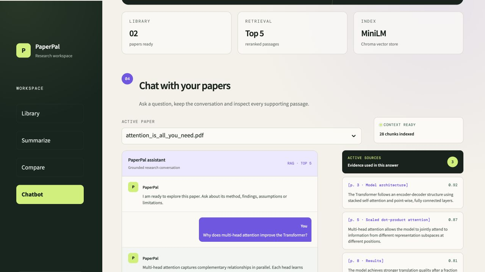
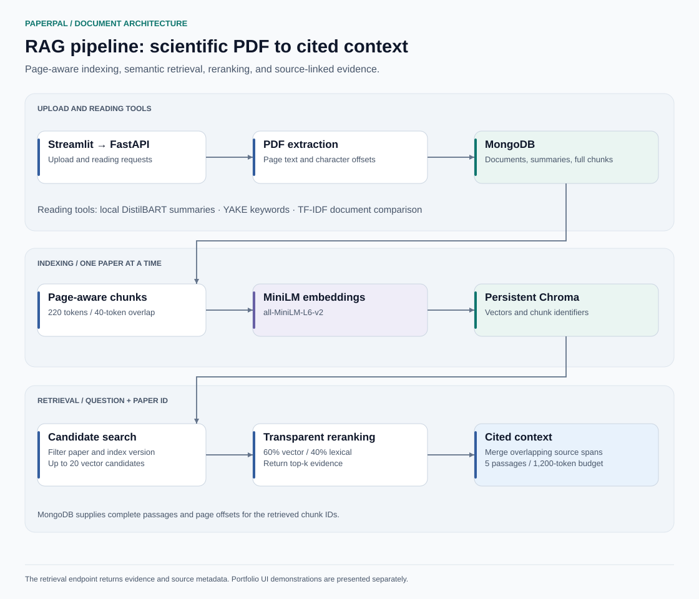
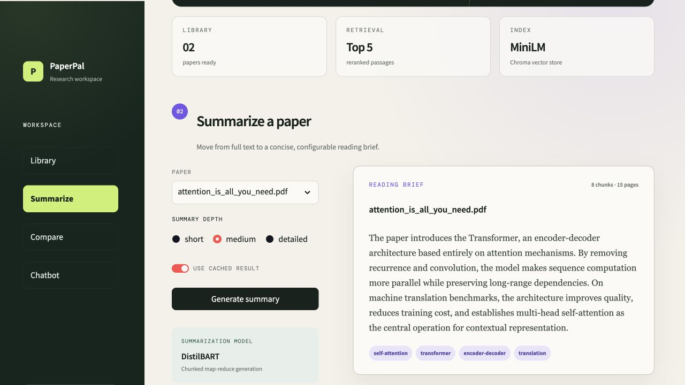
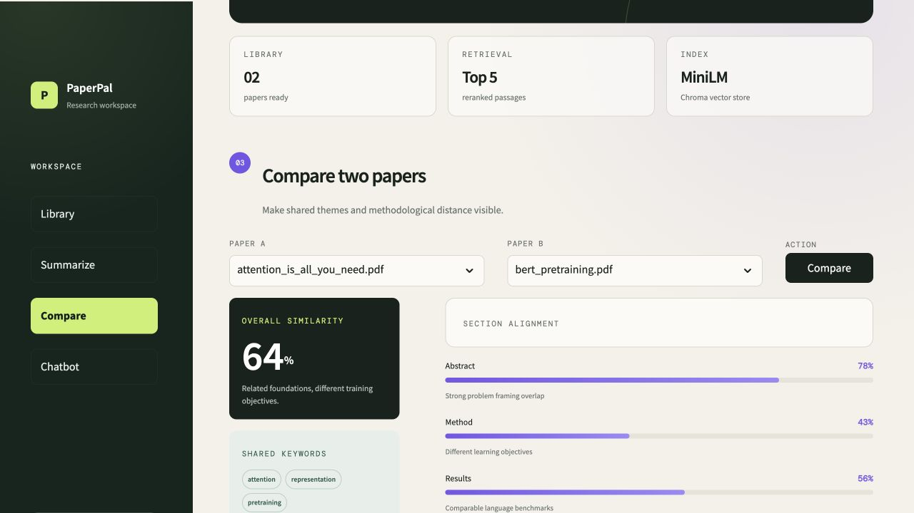

# PaperPal: RAG for Scientific Papers

A scientific-document **RAG project** built around semantic retrieval, lexical reranking, and **page-linked citation context**. Questions are matched to evidence from indexed papers, with source identifiers and token budgets preserved throughout the retrieval pipeline.

**Stack:** MiniLM · Chroma · MongoDB · FastAPI · Streamlit · PyMuPDF

The AI engineering focus is the path from a scientific PDF to **retrievable, ranked, citation-ready evidence**: page-aware chunking, dense embeddings, semantic search, lexical reranking, and context construction. The research-chat demonstration shows how that evidence supports document-grounded interaction.

[Portfolio case study](https://zakilbaki.github.io/Zakaria_Ouahabi/) · [RAG design and evaluation](docs/rag-architecture-decisions.md)

## Research-chat walkthrough

The portfolio presents a chatbot interface alongside the passages supporting its responses. The demonstrations describe that case-study experience; the local setup below runs the document-processing and retrieval implementation in this repository.



[Watch the chatbot demonstration](https://raw.githubusercontent.com/zakilbaki/Zakaria_Ouahabi/main/assets/visuals/paperpal/paperpal-chatbot.gif) · [Watch the document workflow](https://raw.githubusercontent.com/zakilbaki/Zakaria_Ouahabi/main/assets/visuals/paperpal/paperpal-workflow.gif) · [Document library](docs/assets/paperpal-library.png)

## RAG pipeline



[Diagram source](docs/visuals/visual_spec.json)

The implemented retrieval path returns passages and citation context. The document record remains the shared source for summaries, comparison, and indexing.

| RAG stage | Implementation |
| --- | --- |
| Parse and preserve provenance | PyMuPDF page text and character offsets in MongoDB |
| Chunk | Page-aware, sentence-aware chunks: 220 tokens, 40-token overlap |
| Embed and index | MiniLM embeddings and persistent Chroma storage |
| Retrieve | Filter by paper and index version; up to 20 vector candidates |
| Rerank | 60% vector similarity and 40% lexical coverage |
| Build context | Merge overlapping spans; retain chunk IDs and stable citation labels |
| Control context size | Up to five passages within a 1,200-token budget |

Indexing and question answering use separate paths. Indexing persists the document's chunks and embeddings once; each question is embedded, searched against the selected paper, reranked, and assembled into a bounded evidence packet. The retrieval response exposes vector and lexical scores alongside page offsets and source chunk IDs, so the selected context can be inspected.

[Chunking](backend/app/rag/chunking.py) · [Retrieval](backend/app/rag/retrieval.py) · [Reranking](backend/app/rag/reranking.py) · [Context construction](backend/app/rag/context.py)

## Recorded retrieval study

The documented experiment uses **three scientific papers, 57 pages, and 332 chunks**, with 18 labelled answerable questions and six unsupported questions.

| Metric on answerable questions | Recorded result |
| --- | ---: |
| Page Recall@1 | 0.778 |
| Page Recall@3 | 0.944 |
| Page Recall@5 | 1.000 |
| MRR@10 | 0.854 |

These are results from the small recorded retrieval experiment, not generated-answer accuracy. The [design and evaluation record](docs/rag-architecture-decisions.md) gives the corpus, stage-specific experiments, and context-budget checks.

## Reading tools

The same document store also supports local DistilBART summaries, YAKE keywords, and overall or section-level TF-IDF comparisons.

| Summarize a paper | Compare methods |
| --- | --- |
|  |  |

The summarization route processes up to eight chunks per request; use the source PDF for complete coverage of longer documents.

## Run locally

With Docker and Docker Compose:

```bash
docker compose up --build
```

| Service | Local address |
| --- | --- |
| Reading interface | http://localhost:8501 |
| API documentation | http://localhost:8000/docs |
| Health endpoint | http://localhost:8000/api/v1/health/ |

The default stack uses local MongoDB and Chroma volumes. Model weights download on first use. The Compose configuration defines the available environment settings; `.env.example` documents optional overrides.

## API workflow

Upload a PDF:

```bash
curl -X POST http://localhost:8000/api/v1/papers/upload \
  -F 'file=@paper.pdf'
```

Use its returned document identifier as `PAPER_ID`, then index and query it:

```bash
curl -X POST "http://localhost:8000/api/v1/papers/${PAPER_ID}/rag/index"

curl -X POST "http://localhost:8000/api/v1/papers/${PAPER_ID}/rag/retrieve" \
  -H 'Content-Type: application/json' \
  -d '{"question":"What method was used?","top_k":5}'
```

Retrieval returns ranked passages, source metadata, and a bounded context packet. Index version and embedding identity are checked before querying.

## Engineering decisions

- **Shared document storage:** reading tools use the same persisted document rather than independently extracting each PDF.

- **Separate text and vector storage:** MongoDB retains content and provenance; Chroma supports similarity search.

- **Inspectable reranking:** a 60% vector and 40% lexical score combines semantic retrieval with explicit query-term coverage.

- **Bounded context:** the default evidence packet allows five passages and a 1,200-token budget.

## Repository guide

| Path | Contents |
| --- | --- |
| `backend/app/api/v1/` | Upload, summary, comparison, and retrieval routes |
| `backend/app/rag/` | Chunking, indexing, retrieval, reranking, and context |
| `backend/app/services/` | Parsing, keywords, and summarization |
| `backend/tests/` | API and deterministic processing tests |
| `frontend/streamlit_app.py` | Reading interface |

The dependency setup and test command are recorded in [.github/workflows/ci.yml](.github/workflows/ci.yml). The [retrieval design record](docs/rag-architecture-decisions.md) explains the implementation in more detail.
